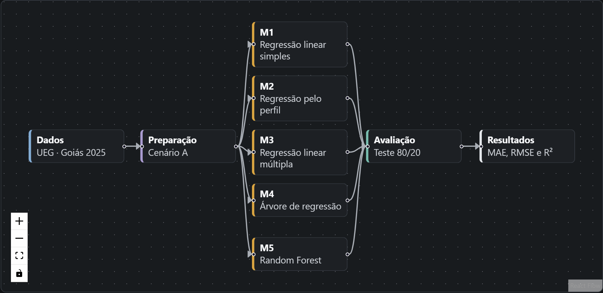

# VETOR · Laboratório Visual de IA

O VETOR estima a taxa de aprovação do 6º ao 9º ano em escolas de Goiás usando indicadores de 2025. Na bancada visual, é possível conectar modelos, executar os protocolos de avaliação e inspecionar as diferenças entre as taxas estimadas e observadas.

Projeto Integrador da disciplina de Inteligência Artificial, curso de Sistemas de Informação da Universidade Estadual de Goiás (UEG), Unidade Universitária de Trindade.

[Ler o relatório final (PDF)](Projeto%20Integrador%20de%20IA%20-%20Educa%C3%A7%C3%A3o.pdf)



## Executar no Windows

1. Clone este repositório ou baixe e extraia o ZIP em **Code → Download ZIP**.
2. Com o **Python 3.12 de 64 bits** disponível, abra `iniciar.bat` na pasta do projeto. O inicializador cria a pasta `.venv` e instala as dependências de `requirements.txt`. A instalação inicial precisa de internet. Com as dependências instaladas, a aplicação funciona offline.
3. Abra o endereço exibido no terminal, normalmente [127.0.0.1:8501](http://127.0.0.1:8501), e mantenha o terminal aberto.
4. Clique em **Abrir exemplo**, escolha o protocolo no bloco **Avaliação** e clique em **Executar fluxo**. No bloco **Resultados**, veja o ranking, expanda **Referências estatísticas e partições** ou abra **Diagnóstico por escola**.
5. Para o **cenário B**, escolha **Cenário B · perfil ampliado** em **Preparação**, deixe apenas M2 ligado à avaliação e execute o teste 80/20.

## Experimentos

O **cenário A** usa 850 escolas com a taxa de aprovação dos anos iniciais disponível. Compara regressão linear simples (M1), regressão por perfil (M2), regressão múltipla (M3), árvore de regressão (M4) e Random Forest (M5). O **cenário B** inclui 1.742 escolas e usa M2 com localização e rede de ensino.

| Protocolo | Escolas avaliadas | Menor RMSE entre os modelos fixos |
| --- | ---: | --- |
| A · teste 80/20 | 170 | M3 · 3,221 p.p. |
| A · validação cruzada | 680 | M4 · 3,211 p.p. |
| A · validação aninhada | 850 | M5 · 3,491 p.p. |
| B · teste 80/20 | 349 | M2 · 2,721 p.p. |

O relatório recomenda M3 para análise exploratória porque é possível explicar a contribuição de cada entrada. Na validação aninhada, a regra de seleção interna obteve RMSE de 3,941 p.p. No cenário B, a mediana do treino (100%) teve o menor MAE, de 1,408 p.p., e M2 teve o menor RMSE, de 2,721 p.p.

As estimativas são contemporâneas a 2025. A base permite estudar associações e erros por escola. Para prever outros anos ou avaliar efeitos causais, seriam necessários dados e protocolos adequados a essas perguntas.

## Reproduzir os resultados

Execute na raiz do projeto após instalar as dependências:

```powershell
.\.venv\Scripts\python.exe -X utf8 testes.py
```

Para reexecutar os experimentos e atualizar os CSVs:

```powershell
.\.venv\Scripts\python.exe -X utf8 testes.py --exportar resultados
```

Os roteiros de navegador requerem Node.js, Google Chrome e Playwright. Com o VETOR rodando, execute em outro PowerShell na raiz do projeto:

```powershell
npm.cmd install --no-save --no-package-lock playwright
node resultados/conferir_protocolos.cjs
node resultados/testar_interface.cjs
```

Caso o Streamlit use outra porta, defina `$env:VETOR_PORT` com esse número antes de executar os roteiros. O [registro de testes](testes.txt) documenta as versões, os cenários e os resultados de cada rodada.

## Estrutura

| Caminho | Conteúdo |
| --- | --- |
| `app.py`, `estilo.css`, `.streamlit/` | Interface Streamlit, editor visual e configuração local |
| `fluxo.py`, `motor.py`, `paineis.py` | Validação das conexões, modelos Orange3, métricas e visualizações |
| [`dados/`](dados/) | Base de Goiás, dicionário de atributos e partições dos experimentos |
| [`resultados/`](resultados/) | Métricas, previsões por escola, seleção interna e testes de navegador |
| [`prints/`](prints/) | Capturas da bancada, das avaliações e dos diagnósticos |
| `testes.py`, `testes.txt` | Suíte Python e evidências de execução |

Os dados foram fornecidos na disciplina a partir das [Taxas de Rendimento Escolar do Inep](https://www.gov.br/inep/pt-br/acesso-a-informacao/dados-abertos/indicadores-educacionais/taxas-de-rendimento-escolar). A [conferência da origem](resultados/inep.txt) documenta o recorte de Goiás.

**Equipe:** Adail de Oliveira, Diego Abreu, Geanderson Augusto e Shinayder Anjos.

**Professor:** Rafael Viana de Carvalho.
